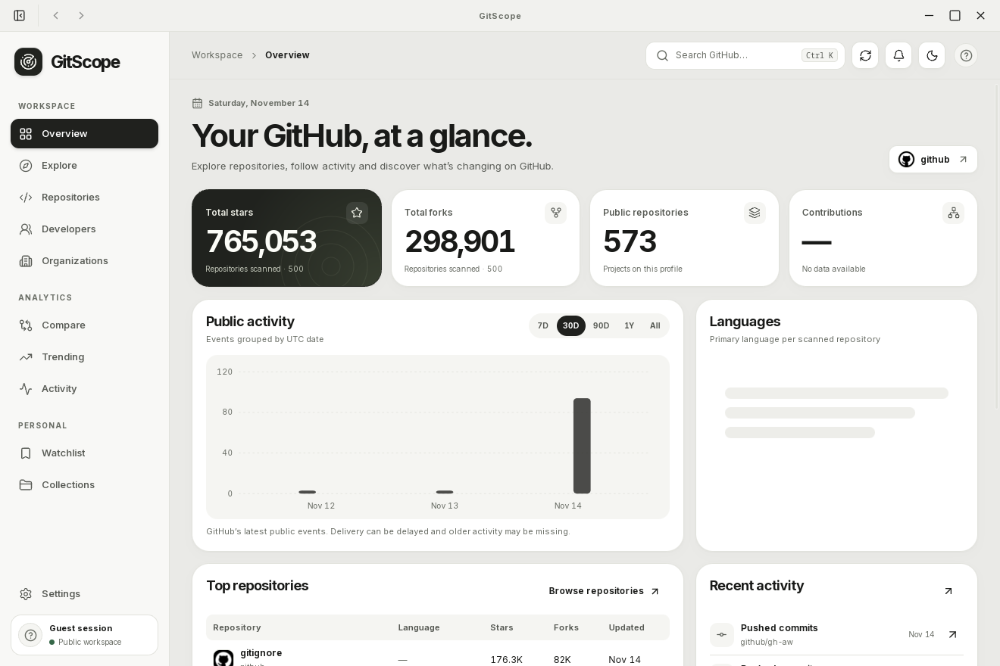
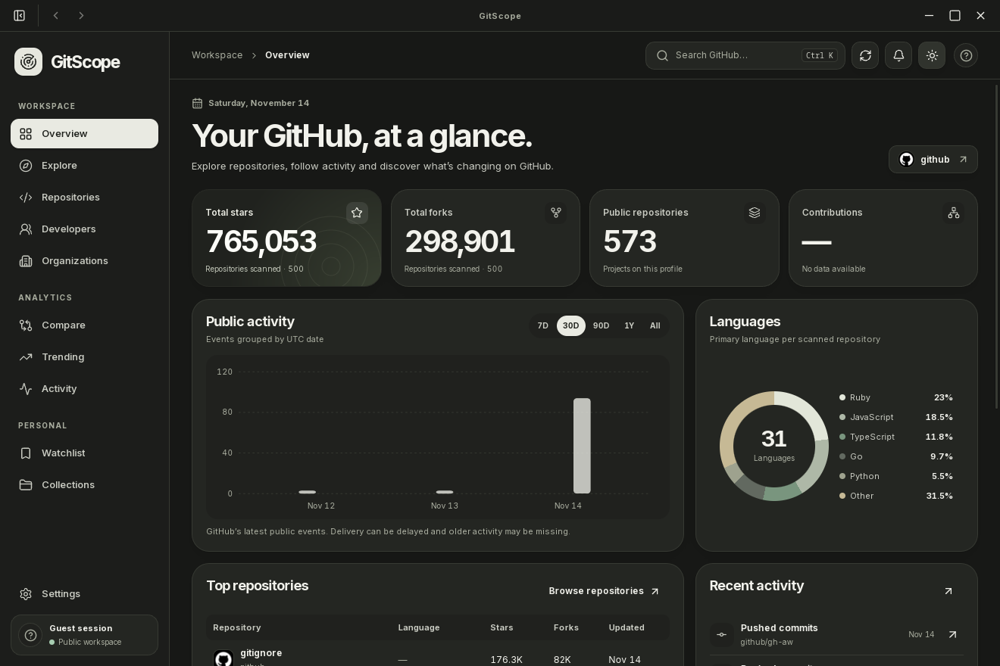
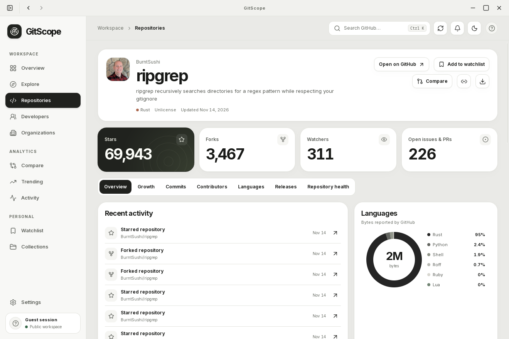

# GitScope

A Linux desktop application for exploring, analyzing and tracking public
GitHub projects. Search repositories, users and organizations, compare
projects side by side, follow releases of a personal watchlist and inspect
activity, commits, contributors and language composition — from a native
window with a local database and an offline response cache.


## Screenshots

| Light theme | Dark theme |
| --- | --- |
|  |  |



## Features

- **Overview.** Aggregate metrics for any public profile or organization:
  stars, forks, repository count, public activity, language composition and
  top repositories, sampled from up to 500 recently updated projects.
- **Explore.** Full GitHub Search syntax for repositories, users and
  organizations with server-side filters and pagination.
- **Repository analytics.** Stars, forks, watchers, open issues, growth,
  commits, contributors, languages, releases and repository health on one
  page, with daily local snapshots preserved over time.
- **Compare.** Side-by-side metrics for up to four repositories.
- **Trending.** Discovery mode ranks repositories created since a selected
  date by total stars; observed growth uses local daily snapshots.
- **Watchlist and collections.** Track repositories, receive release
  notifications while the app is open, organize entries with tags and
  collections.
- **Contributions calendar.** GraphQL-based calendar for authenticated
  user profiles.
- **Local-first storage.** Settings, snapshots, notifications and cached
  responses live in SQLite; previously fetched data stays available when
  GitHub is unreachable.

## Installation

Download the current standalone executable from the
[Releases](https://github.com/devodrag/GitScope/releases) page, make it
executable and run it:

```bash
chmod +x gitscope
./gitscope
```

To register the application in the desktop menu without administrator
access, run the bundled installer:

```bash
bash scripts/install-linux.sh /absolute/path/to/gitscope
```

The binary requires glibc 2.34 or newer and uses the system copies of
GTK 3, WebKitGTK 4.1, SQLite and D-Bus. Debian, Fedora and AppImage
packages can be produced from source as described below.

## Build from source

Install Rust 1.90 or newer, Cargo, a C toolchain, Node 22.13+ or 24+, npm,
pkg-config, Clang/libclang, GTK 3, WebKitGTK 4.1, SQLite development
headers, D-Bus development headers and the remaining Tauri prerequisites
for your distribution.

| Distribution | System dependencies |
| --- | --- |
| Debian/Ubuntu | `sudo apt install build-essential curl wget file libwebkit2gtk-4.1-dev libxdo-dev libssl-dev libayatana-appindicator3-dev librsvg2-dev pkg-config clang libclang-dev libsqlite3-dev libdbus-1-dev xdg-utils libnotify-bin` |
| Fedora | `sudo dnf install gcc gcc-c++ make webkit2gtk4.1-devel openssl-devel curl wget file libxdo-devel libayatana-appindicator-gtk3-devel librsvg2-devel pkgconf-pkg-config clang clang-devel sqlite-devel dbus-devel xdg-utils libnotify` |
| Arch/EndeavourOS | `sudo pacman -S --needed base-devel webkit2gtk-4.1 gtk3 libxdo librsvg libayatana-appindicator sqlite clang dbus xdg-utils libnotify` |

```bash
npm ci
npm run tauri -- dev
npm run tauri -- build --bundles deb,rpm
npm run tauri -- build --bundles appimage
```

Tauri writes the application to `src-tauri/target/release/gitscope` and
packages to `src-tauri/target/release/bundle/`. Build the AppImage
separately so a missing linuxdeploy tool does not interrupt Debian and
Fedora packaging.

## Signing in to GitHub

Public search, repository analytics, comparison and watchlists work in
guest mode. To enable the contributions calendar and authenticated API
limits, go to **Settings → GitHub account → Use a GitHub token** and paste
a classic personal access token (`ghp_…`) created with every scope
unchecked. Fine-grained tokens (`github_pat_…`) and tokens with any scope
enabled are rejected by design; the application verifies this at GitHub's
authenticated user endpoint. The token is stored only in the local SQLite
database and never leaves the machine.

OAuth Device Flow is also available:

1. Register a dedicated GitHub OAuth App under **GitHub → Settings →
   Developer settings → OAuth Apps** and enable Device Flow.
2. Paste its public Client ID into **GitScope → Settings → GitHub account**.
   Distributors can supply the ID at compile time with
   `GITSCOPE_GITHUB_CLIENT_ID`.
3. Open the verification page from GitScope, enter the displayed code and
   approve the request.

Sign out locally from Settings. GitHub's Authorized OAuth Apps page allows
revoking authorization on the GitHub side.

## Usage

- The first Overview opens the public `github` organization; choose another
  profile with the button beside the heading.
- Repositories accepts `owner/name` or a GitHub repository URL. The Growth
  tab becomes informative after snapshots have accumulated on separate UTC
  dates.
- Watchlist refresh checks for releases while GitScope is open. Attach tags
  and collections through the edit button on a watched repository.
- Keyboard: `Ctrl+K` command palette, `Ctrl+R` refresh, `Ctrl+,` settings,
  `Ctrl+1–4` Overview/Explore/Repositories/Compare, `Esc` close dialogs,
  `F11` fullscreen.
- Settings control theme, language (English, Russian), density, cache size
  and refresh interval. Export writes a JSON file through a native file
  picker.

## Development checks

```bash
npm run typecheck
npm run lint
npm test
npm run build
cargo check --manifest-path src-tauri/Cargo.toml
cargo test --manifest-path src-tauri/Cargo.toml
cargo clippy --manifest-path src-tauri/Cargo.toml --all-targets -- -D warnings
```

UI integration tests use an explicit IPC fixture in a test-only browser
process. Set `GITSCOPE_TEST_BROWSER` to reuse an installed Chromium binary
for those tests.

## Documentation

- [ARCHITECTURE.md](ARCHITECTURE.md) — layer model, data sources, metric
  definitions, cache semantics and the security model.
- [VERIFICATION.md](VERIFICATION.md) — build, smoke-test and performance
  results for released versions.

Third-party references:

- [Tauri Linux prerequisites](https://v2.tauri.app/start/prerequisites/)
- [Tauri AppImage distribution](https://v2.tauri.app/distribute/appimage/)
- [GitHub REST API](https://docs.github.com/en/rest)
- [GitHub OAuth Device Flow](https://docs.github.com/en/apps/oauth-apps/building-oauth-apps/authorizing-oauth-apps#device-flow)

## License

Distributed under the [MIT License](LICENSE). The bundled Inter typeface is
provided under the SIL Open Font License (see `licenses/Inter-OFL.txt`).

## Data location

Local data is stored in the Tauri application data directory for
`app.gitscope.desktop`, which on Linux resolves to
`~/.local/share/app.gitscope.desktop/`.
